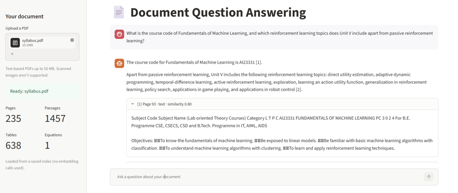
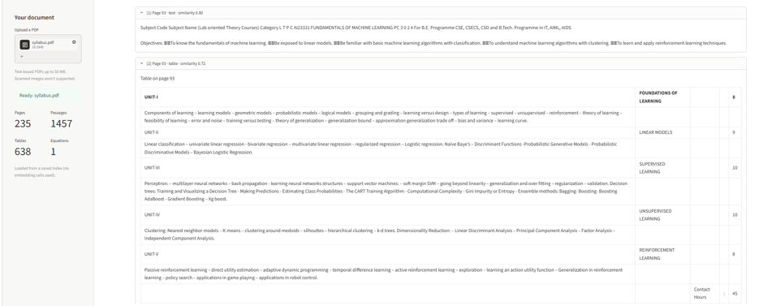
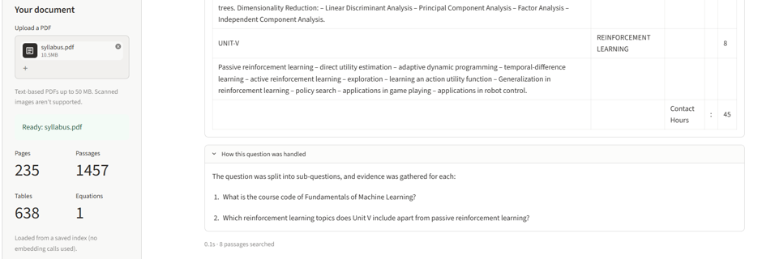
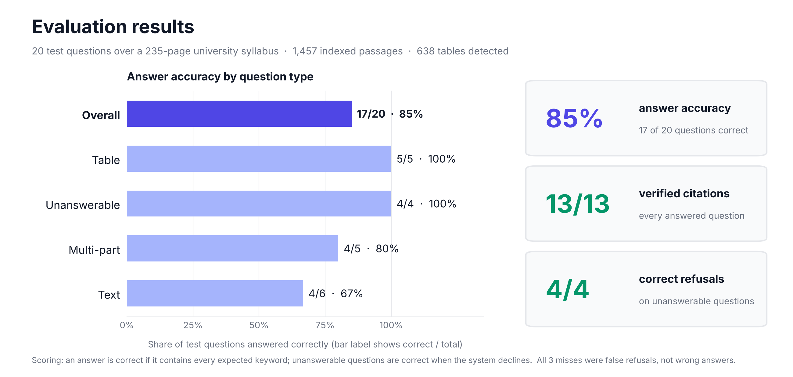
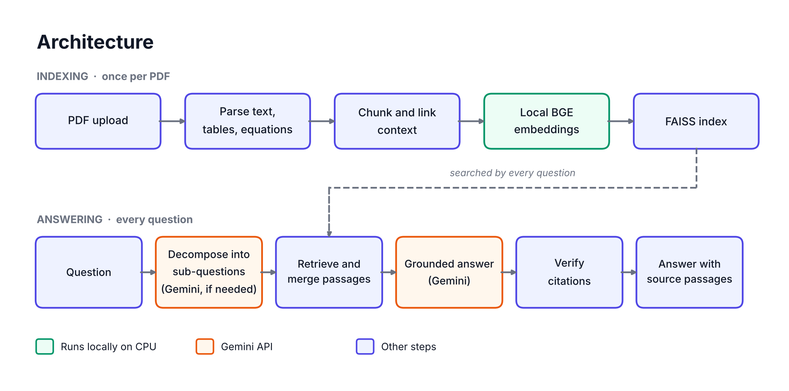
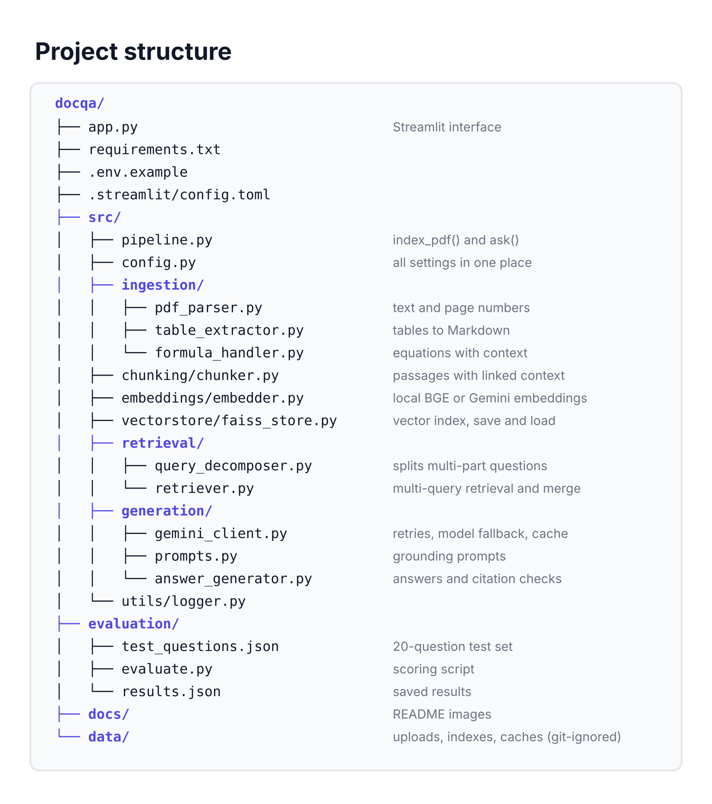

# Intelligent Document Question Answering System

Ask questions about any text-based PDF and receive answers grounded in the document, with citations programmatically verified against retrieved passages.

**Tech Stack:** Python | FAISS | BGE Embeddings | Gemini API | Streamlit

   


## Results

### Evaluation Results

Evaluated on a 235-page university syllabus using 20 test questions.

- **Answer Accuracy:** 85% (17 out of 20 questions answered correctly).
- **Citation Verification:** 100% of answered questions carried fully verified citations.
- **Abstention Accuracy:** All 4 unanswerable questions were correctly declined.




## What It Does

- **Chat with PDFs:** Upload a PDF document and ask questions. Each answer includes numbered source passages with page numbers, content types, and similarity scores.

- **Verified Citations:** Validates citations against retrieved passages, removes invalid references, and automatically renumbers the remaining citations.

- **Table-Aware Retrieval:** Extracts tables in Markdown format and stores them with their captions and contextual sentences to improve retrieval for numerical questions.

- **Question Decomposition:** Breaks complex, multi-part questions into smaller sub-questions and retrieves supporting evidence for each.

- **Grounded Answers:** Restricts responses to retrieved document passages and explicitly indicates when the document does not contain sufficient information.

- **Quota-Efficient Architecture:** Runs embeddings locally on the CPU, using Gemini only for question decomposition and answer generation. Implements retries, model fallback, and answer caching to manage free-tier API limits.

## Architecture



## Project structure



## Quick Start

### Prerequisites
- Python 3.10+
- Gemini API key from [Google AI Studio](https://aistudio.google.com/apikey)

### 1. Clone the repository
```bash
git clone <repository-url>
cd <project-folder>
```

### 2. Create and activate a virtual environment
```bash
python -m venv .venv
.venv\Scripts\Activate.ps1
```

### 3. Install dependencies
```bash
pip install -r requirements.txt
```

### 4. Configure environment variables

Copy `.env.example` to `.env` and add your Gemini API key:

```env
GEMINI_API_KEY=your_key_here
LLM_MODEL=gemini-3.5-flash
LLM_FALLBACK_MODELS=gemini-3.6-flash,gemini-3.5-flash-lite,gemini-3.1-flash-lite
EMBEDDING_PROVIDER=local
```

### 5. Run the application
```bash
python -m streamlit run app.py
```

**Note:** The first run downloads the embedding model (approximately 130 MB).

## About the Evaluation

- Evaluated 20 questions: 6 text, 5 table, 5 multi-part, and 4 unanswerable.
- Questions and expected keywords were AI-assisted and manually verified against the extracted PDF text.
- Correctness was measured using keyword matching; unanswerable questions were correct when the system declined.
- All 3 incorrect results were false refusals. Their cause remains undiagnosed.
- This is an initial evaluation on one document type, with no baseline comparison. Equation handling was not evaluated.

### Reproduce Evaluation

Copy the syllabus to `data/uploads/syllabus.pdf`, then run:

```bash
python evaluation/evaluate.py --check
python evaluation/evaluate.py


